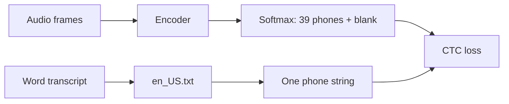
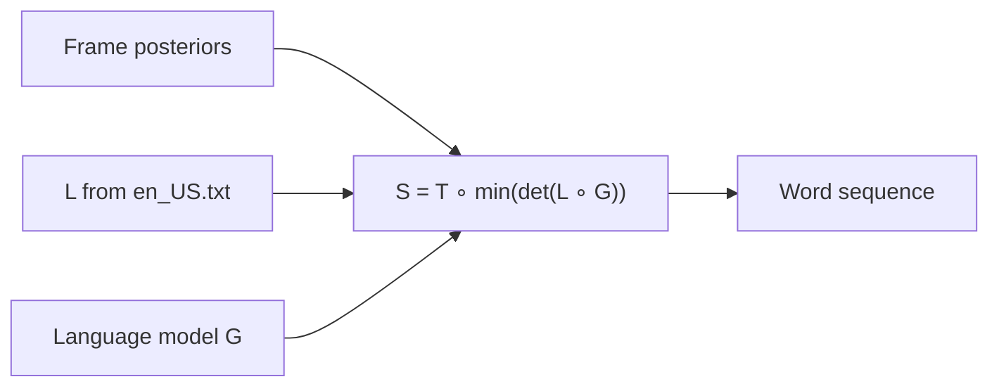
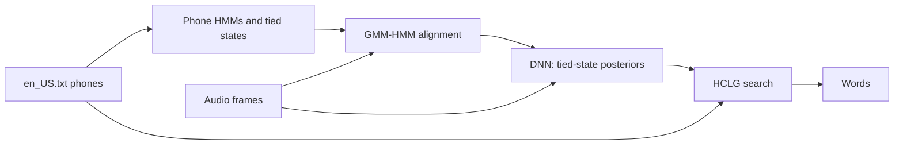

# IPA phones in an encoder + CTC recognizer

`ipa-dict/data/en_US.txt` is the pronunciation lexicon. An encoder + CTC recognizer uses it twice: once to build the training targets, and again at decoding to turn phone sequences back into words. This note is the pipeline. The cited papers are the sources for the loss, the lexicon search, and the IPA phone experiments. Nothing in this repository has been trained, so the error rates below are those papers' results.

The phone strings come from the tokenizer in the [CTC targets](../README.md#ctc-targets) section of the README.

## What is trained

The acoustic model maps a sequence of audio frames to a distribution over IPA phones plus one extra blank label. Connectionist temporal classification (CTC) trains that model from a phone string, without a frame-level alignment [Graves et al. 2006](http://www.cs.utoronto.ca/~graves/icml_2006.pdf).

Word transcripts are the usual supervision. The lexicon turns each word into phones before the loss is computed. At recognition time the model still emits phones. A search graph compiled from the same lexicon, and optionally a language model, turns those phones into words [Miao, Gowayyed, and Metze 2015](https://arxiv.org/abs/1507.08240).



## From a transcript to a phone target

Look each word up in `en_US.txt`, take one pronunciation, strip the slashes, and split it into the phones listed in the README. Drop the stress marks `ˈ` and `ˌ` for the CTC alphabet. Stress in this file is a mark on the syllable. The phoneme CTC systems below train on phone identity, and the CMU dictionary entries they use do not put stress in the label set as its own symbol.

CTC is defined on one label sequence per utterance [Graves et al. 2006](http://www.cs.utoronto.ca/~graves/icml_2006.pdf). A spelling such as `read` has two pronunciations here (`/ˈɹɛd/` and `/ˈɹid/`). EESEN keeps the first pronunciation of each word because the training transcript does not say which reading was spoken [Miao, Gowayyed, and Metze 2015](https://arxiv.org/abs/1507.08240). Use a later pronunciation only when the transcript tells you the reading.

There is no word-boundary phone. Character CTC often inserts a space between words. Phoneme CTC concatenates the word pronunciations into one string, and the lexicon puts the boundaries back during decoding.

`a canadian computer` becomes:

| Word | First field in `en_US.txt` | CTC phones |
| --- | --- | --- |
| a | `/ˈeɪ/, /ə/` | `eɪ` |
| canadian | `/kəˈneɪdiən/` | `k ə n eɪ d i ə n` |
| computer | `/kəmˈpjutɝ/` | `k ə m p j u t ɝ` |

The target is one sequence of 17 phones:

```text
eɪ k ə n eɪ d i ə n k ə m p j u t ɝ
```

```python
STRESS = {"ˈ", "ˌ"}

def ctc_target(words: list[str], lexicon: dict[str, str]) -> list[str]:
    tokens = []
    for word in words:
        field = lexicon[word.lower()]          # missing word: see OOV below
        phones = pronunciations(field)[0]      # first pronunciation
        tokens.extend(phone for phone in phones if phone not in STRESS)
    return tokens
```

`pronunciations()` is the splitter in the README. The CTC vocabulary is those 39 phones plus blank, so the softmax has 40 classes:

| Group | Tokens |
| --- | --- |
| Affricates | `tʃ` `dʒ` |
| Diphthongs | `aɪ` `aʊ` `eɪ` `oʊ` `ɔɪ` |
| Vowels | `i` `u` `ɪ` `ɛ` `æ` `ɑ` `ɔ` `ʊ` `ə` `ɝ` |
| Consonants | `b` `d` `f` `h` `j` `k` `m` `n` `p` `s` `t` `v` `w` `z` `ð` `θ` `ʃ` `ʒ` `ŋ` `ɡ` `ɫ` `ɹ` |
| CTC | `∅` blank |

A whole IPA string as one label would be a class per lexicon entry, about 126,000 classes for this file, with no shared `k` or `ə` between `canada` and `canadian`. A phone inventory shares those units across words. Graves and Jaitly trained CTC on characters instead, which also keeps the alphabet small and removes the need for a pronunciation dictionary [Graves and Jaitly 2014](https://proceedings.mlr.press/v32/graves14.html). Rao, Sak, and Prabhavalkar later compared graphemes, phonemes, and wordpieces and got their best word error with wordpieces [Rao, Sak, and Prabhavalkar 2017](https://arxiv.org/abs/1801.00841). Phones remain the unit that this lexicon defines.

## Encoder

The encoder reads a sequence of acoustic frames and writes one vector per output step. CTC does not require a particular encoder. Graves et al. used a bidirectional LSTM. EESEN used a stack of bidirectional LSTM layers and called that stack the acoustic model. A convolutional or Conformer encoder fits the same loss as long as it produces one distribution per time step.

Each vector goes through a linear layer and a softmax of size 40. Frame \(t\) emits \(y_t^k = P(k \mid X)\) for phone \(k\) or blank. CTC treats those frame outputs as conditionally independent given the encoder state [Graves et al. 2006](http://www.cs.utoronto.ca/~graves/icml_2006.pdf). Any language-model dependency between phones is left to the decoder, or to a transducer that adds a prediction network [Graves 2012](https://arxiv.org/abs/1211.3711).

Typical front ends in these papers are mel filterbank or MFCC frames every 10 ms. The encoder may downsample in time. The only length constraint is that the target phone string must be no longer than the encoder output.

## CTC loss

Let the target be \(z = z_1, \ldots, z_U\) over the 39 phones, and let the encoder emit \(T\) frames with \(T \ge U\). A CTC path \(p\) is a length-\(T\) sequence over phones and blank. The many-to-one map \(\mathcal{B}\) deletes the blanks and then collapses each run of the same phone:

```text
B(∅ k k æ ∅ n ə d ∅ ə) = k æ n ə d ə
```

So several paths spell the same target. One of them, lined up under a short stretch of audio for `canada`, looks like this:

```text
frames   1  2  3  4  5  6  7  8  9  10
path     ∅  k  k  æ  ∅  n  ə  d  ∅  ə
target      k     æ     n  ə  d     ə
```

The same phone on two adjacent frames is one phone after \(\mathcal{B}\). A real geminate, the same phone twice in the target, is representable only when a blank sits between the two spikes. That shows up across a word boundary when one word ends with the phone that the next word starts with.

The probability of the target is the sum of the probabilities of every path that collapses to it:

\[
P(z \mid X) = \sum_{p \in \mathcal{B}^{-1}(z)} \prod_{t=1}^{T} y_t^{p_t}
\]

The training loss is \(-\log P(z \mid X)\). The sum is computed with the forward-backward algorithm on a trellis that inserts a blank before, after, and between the phones of \(z\) [Graves et al. 2006](http://www.cs.utoronto.ca/~graves/icml_2006.pdf). EESEN writes the same recursion for an RNN acoustic model [Miao, Gowayyed, and Metze 2015, §2.2](https://arxiv.org/abs/1507.08240).

Trained CTC outputs are peaky. Most frames are blank, and each phone is a short spike [Graves et al. 2006](http://www.cs.utoronto.ca/~graves/icml_2006.pdf). The phone error you monitor during training is the edit distance after greedy collapse: take \(\arg\max\) at each frame, apply \(\mathcal{B}\), and compare with \(z\).

## Decoding phones into words

Greedy collapse produces a phone string with no word boundaries. `k æ n ə d ə` might be the word `canada`, but the decoder does not know the cuts. Search has to consume phones and emit words.

EESEN builds three weighted finite-state transducers and composes them [Miao, Gowayyed, and Metze 2015, §3.1](https://arxiv.org/abs/1507.08240):

| Transducer | Input | Output | Role for this lexicon |
| --- | --- | --- | --- |
| \(T\) token | frame-level CTC labels, including blank and repeated phones | one phone | implements \(\mathcal{B}\) inside the search |
| \(L\) lexicon | phone string | one word | one path per pronunciation in `en_US.txt` |
| \(G\) grammar | words | words | n-gram language model, or a trivial graph that accepts any word sequence |

The search graph is

\[
S = T \circ \min(\det(L \circ G))
\]

\(\circ\) is composition, \(\det\) determinization, and \(\min\) minimization. \(S\) reads a CTC label sequence and writes words. Mohri, Pereira, and Riley develop that composition for the older HMM stack, where the lexicon is the transducer from phones to words [Mohri, Pereira, and Riley 2008](https://cs.nyu.edu/~mohri/pub/hbka.pdf). EESEN keeps \(L\) and \(G\) and replaces the HMM and context-dependency transducers with \(T\).

On the Wall Street Journal `eval92` set, EESEN's phoneme CTC model with the CMU dictionary and a language model reached 7.87% word error. That number is their WSJ result with their phone set, which had 72 labels including noise marks and blank. It is an existence result for this design.

A small decoder without OpenFst is a beam of lexicon prefixes. Each step consumes the next collapsed phone and extends every lexicon entry that has that phone continuation. Reaching the end of an entry emits the word and starts again at the lexicon root. \(G\) rescores the word sequence. Several pronunciations of one word can all sit in \(L\) at decode time. Training still used a single pronunciation per utterance.



## Words missing from the lexicon

A word absent from `en_US.txt` has no phone target, so that utterance cannot enter the CTC sum until a pronunciation exists. Two practical choices:

- Skip the utterance, or skip the unknown word, and train on the covered vocabulary.
- Generate a pronunciation with a grapheme-to-phoneme model and add it to the lexicon.

Joint-sequence models learn that generator from the existing dictionary: they align letters and phones as graphone sequences and generalize to unseen spellings [Bisani and Ney 2008](https://doi.org/10.1016/j.specom.2008.01.002). EESEN notes the same gap. A character lexicon can add an unknown spelling for free. A phone lexicon cannot, until G2P supplies the phones [Miao, Gowayyed, and Metze 2015, §3.1](https://arxiv.org/abs/1507.08240).

Train the G2P model on `en_US.txt` so its phone inventory matches the 39 labels above. A predicted string that uses some other IPA symbol is outside the softmax.

## Other languages in this checkout

Every `ipa-dict/data/*.txt` file has the same `word<TAB>IPA` shape, so the same training step applies: first pronunciation, strip slashes, longest-match phones, drop stress marks if that language uses them, then CTC. The phone inventory is language-specific. Mandarin in `zh_hans.txt` and `zh_hant.txt` includes tones, and a tone mark is part of the target if you want the model to emit it.

Żelasko, Moro-Velázquez, Hasegawa-Johnson, Scharenborg, and Dehak trained monolingual and multilingual models to emit IPA token sequences [Żelasko et al. 2020](https://arxiv.org/abs/2005.08118). A shared IPA vocabulary improved phone error when each language was in the training mix. A model that had never seen the target language did much worse. Their phone set is the IPA they used for those experiments. Reusing their setup on these files means rebuilding the softmax from the symbols that actually occur in the files you train on.

## Hybrid DNN-HMM

A hybrid DNN-HMM uses the same kind of pronunciation lexicon, then a different acoustic model. No published system trains on this `en_US.txt` file. The papers below put an IPA, or IPA-consistent, phone lexicon in the HMM-DNN stack.

The lexicon still maps a word to a phone string. Each phone is then a small HMM, usually three left-to-right states. Context-dependent phones are clustered into tied states. A GMM-HMM aligns every frame to one tied state, and the DNN is trained with frame-level cross-entropy to predict that state. At decoding, the state posterior is divided by the state prior and used as the HMM emission probability. Hinton et al. describe that recipe [Hinton et al. 2012](https://doi.org/10.1109/MSP.2012.2205597). The English systems in that line use the CMU phone set. `en_US.txt` is an IPA conversion of that dictionary family, so the lexicon role matches and the symbol alphabet does not.



CTC emits the IPA phones. The hybrid DNN emits tied HMM states, and the IPA string is recovered only by the search graph. Because the GMM chooses an alignment, every pronunciation listed for a word can stay in the lexicon. The CTC rule of keeping only the first pronunciation is a CTC limitation.

Stress marks are a poor HMM by themselves. Before building the phone HMMs, drop `ˈ` and `ˌ`, or attach stress to the vowel so `ə` and a stressed vowel are different phones. Vu et al. merge phones that share an IPA symbol, train a Kaldi HMM/GMM and a decision tree on that phoneset, then train the DNN on the tied states [Vu et al. 2014](https://publications.idiap.ch/attachments/papers/2014/Vu_ICASSP_2014.pdf). On GlobalPhone, that IPA merge helped most when the target language had about an hour of speech.

Three hybrid systems sit close to this dictionary:

- **Matassoni, Gretter, Falavigna, and Giuliani** converted Italian, German, and English lexicons into one shared IPA phone set, 67 phones, and trained Kaldi's Karel DNN recipe on the resulting tied states: RBM pretraining, cross-entropy, then sequence-discriminative sMBR. arXiv:[1809.09658](https://arxiv.org/abs/1809.09658).
- **Tachbelie, Abulimiti, Abate, and Schultz** report hybrid HMM-DNN benchmarks, CNN-TDNN-F in Kaldi, for 22 languages whose GlobalPhone dictionaries name phones consistently with the IPA. ICASSP 2020. DOI [10.1109/ICASSP40776.2020.9053144](https://doi.org/10.1109/ICASSP40776.2020.9053144). The dictionary conventions are in Schultz and Schlippe, LREC 2014, [L14-1146](https://aclanthology.org/L14-1146/).
- **Farooq, Narayana, and Hain** build the lexicons with text-to-IPA tools, Epitran and Phonetisaurus, and fuse hybrid TDNN-F acoustic models trained with lattice-free MMI. Interspeech 2022. DOI [10.21437/Interspeech.2022-11449](https://doi.org/10.21437/Interspeech.2022-11449).

To feed `en_US.txt` into that stack, strip the slashes, drop stress or bind it to the vowel, and emit Kaldi's lexicon format: one pronunciation per line, `word phone phone ...`. Multiple pronunciations stay as multiple lines. The DNN output dimension is the number of tied states, often a few thousand, rather than the 40-way phone-plus-blank softmax of the CTC model.

## Papers

Read them in this order if the goal is to implement the pipeline.

1. **Graves, Fernández, Gomez, and Schmidhuber. "Connectionist Temporal Classification: Labelling Unsegmented Sequence Data with Recurrent Neural Networks." ICML, 2006.** DOI [10.1145/1143844.1143891](https://doi.org/10.1145/1143844.1143891). [Local PDF](papers/graves-2006-ctc.pdf). Defines the blank, the collapse map \(\mathcal{B}\), the forward-backward loss, and the first phoneme CTC experiments on TIMIT.

2. **Miao, Gowayyed, and Metze. "EESEN: End-to-End Speech Recognition using Deep RNN Models and WFST-based Decoding." ASRU, 2015.** arXiv:[1507.08240](https://arxiv.org/abs/1507.08240). [Local PDF](papers/miao-2015-eesen.pdf). The system this lexicon plugs into: a bidirectional LSTM, CTC over context-independent phones, the CMU dictionary as \(L\), and \(S = T \circ \min(\det(L \circ G))\). Also the reason to keep one pronunciation per word during training.

3. **Mohri, Pereira, and Riley. "Speech Recognition with Weighted Finite-State Transducers." In *Springer Handbook of Speech Processing*, 2008.** [Local PDF](papers/mohri-2008-wfst.pdf). How a pronunciation dictionary becomes a transducer from phones to words, and how composition with a grammar builds the search graph.

4. **Graves and Jaitly. "Towards End-to-End Speech Recognition with Recurrent Neural Networks." ICML, 2014.** [PMLR 32](https://proceedings.mlr.press/v32/graves14.html). [Local PDF](papers/graves-2014-end-to-end.pdf). Character CTC on Wall Street Journal, including the case with a word lexicon and no phonetic dictionary. The comparison point if the phone lexicon is more machinery than the domain needs.

5. **Bisani and Ney. "Joint-sequence models for grapheme-to-phoneme conversion." *Speech Communication* 50(5), 2008.** DOI [10.1016/j.specom.2008.01.002](https://doi.org/10.1016/j.specom.2008.01.002). How to invent a pronunciation for a spelling that `en_US.txt` does not contain. The Elsevier PDF is not openly downloadable, and the HAL copy blocked this download.

6. **Żelasko, Moro-Velázquez, Hasegawa-Johnson, Scharenborg, and Dehak. "That Sounds Familiar: an Analysis of Phonetic Representations Transfer Across Languages." Interspeech, 2020.** arXiv:[2005.08118](https://arxiv.org/abs/2005.08118). [Local PDF](papers/zelasko-2020-ipa-transfer.pdf). IPA tokens as the ASR output, shared across languages. Relevant once more than `en_US.txt` is in the training mix.

7. **Rao, Sak, and Prabhavalkar. "Exploring Architectures, Data and Units for Streaming End-to-End Speech Recognition with RNN-Transducer." ASRU, 2017.** arXiv:[1801.00841](https://arxiv.org/abs/1801.00841). [Local PDF](papers/rao-2018-rnnt-units.pdf). Graphemes, phonemes, and wordpieces as output units. Wordpieces won on their voice-search task. Useful before locking the product to phones.

8. **Graves. "Sequence Transduction with Recurrent Neural Networks." 2012.** arXiv:[1211.3711](https://arxiv.org/abs/1211.3711). [Local PDF](papers/graves-2012-transducer.pdf). The transducer that adds a prediction network on top of an encoder, so the blank-and-phone model is no longer conditionally independent across frames. The next architecture after plain CTC.

Hybrid DNN-HMM, where the lexicon is IPA or IPA-consistent:

9. **Hinton, Deng, Yu, Dahl, Mohamed, Jaitly, Senior, Vanhoucke, Nguyen, Sainath, and Kingsbury. "Deep Neural Networks for Acoustic Modeling in Speech Recognition." *IEEE Signal Processing Magazine*, 2012.** DOI [10.1109/MSP.2012.2205597](https://doi.org/10.1109/MSP.2012.2205597). [Local PDF](papers/hinton-2012-dnn-acoustic.pdf). The hybrid recipe: a DNN predicts tied HMM-state posteriors, and those replace GMM emissions. The standard English version of this recipe uses CMU phones.

10. **Vu, Imseng, Povey, Motlicek, Schultz, and Bourlard. "Multilingual Deep Neural Network Based Acoustic Modeling for Rapid Language Adaptation." ICASSP, 2014.** [Local PDF](papers/vu-2014-multilingual-dnn.pdf). Kaldi HMM-DNN with a phone set merged on shared IPA symbols.

11. **Matassoni, Gretter, Falavigna, and Giuliani. "Non-Native Children Speech Recognition Through Transfer Learning." 2018.** arXiv:[1809.09658](https://arxiv.org/abs/1809.09658). [Local PDF](papers/matassoni-2018-ipa-dnn-hmm.pdf). A shared IPA lexicon across Italian, German, and English inside a Kaldi DNN-HMM.

12. **Tachbelie, Abulimiti, Abate, and Schultz. "DNN-Based Speech Recognition for GlobalPhone Languages." ICASSP, 2020.** DOI [10.1109/ICASSP40776.2020.9053144](https://doi.org/10.1109/ICASSP40776.2020.9053144). Hybrid HMM-DNN benchmarks on dictionaries whose phone names follow the IPA. The IEEE article is not openly downloadable. [Local slides](papers/tachbelie-2020-globalphone-dnn-slides.pdf) are the SigPort deck. Dictionary conventions: **Schultz and Schlippe, "GlobalPhone: Pronunciation Dictionaries in 20 Languages." LREC, 2014.** [Local PDF](papers/schultz-2014-globalphone-dictionaries.pdf).

13. **Farooq, Narayana, and Hain. "Non-linear Pairwise Language Mappings for Low-resource Multilingual Acoustic Model Fusion." Interspeech, 2022.** DOI [10.21437/Interspeech.2022-11449](https://doi.org/10.21437/Interspeech.2022-11449). [Local PDF](papers/farooq-2022-hybrid-fusion.pdf). Hybrid TDNN-F models whose lexicons come from text-to-IPA tools.

The US English list itself is an IPA conversion of CMUdict-style entries. EESEN cites the [CMU Pronouncing Dictionary](http://www.speech.cs.cmu.edu/cgi-bin/cmudict) directly. The upstream credit for `en_US.txt` is [cmudict-ipa](https://github.com/lingz/cmudict-ipa).
